# Cnow – Học lập trình trực tuyến

Cnow là website học lập trình mình xây dựng cho đồ án tốt nghiệp. Bài học được viết dạng văn bản, code mẫu chạy được ngay. Học xong mỗi bài có trắc nghiệm, khi có chỗ chưa hiểu thì hỏi – đáp ngay dưới bài, mỗi khóa có phòng chat riêng, học xong được cấp chứng nhận. Phía quản trị có biểu đồ doanh thu, duyệt khóa học, kiểm duyệt nội dung và nhật ký bảo mật.

> **Thanh toán trong bản này chỉ là mô phỏng.** Các cổng PayPal / VNPay / MoMo đều là bản demo: không có ô nhập thẻ, không trừ tiền thật. Mọi đơn hàng và hóa đơn đều ghi rõ *“DEMO – không phải giao dịch thật”*.

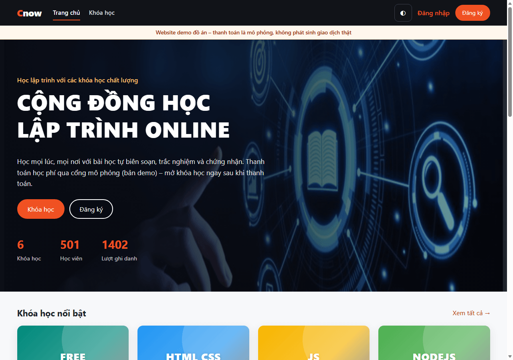

## Về dự án

|                      |                                              |
| -------------------- | -------------------------------------------- |
| Đề tài               | Đồ án tốt nghiệp ngành **An toàn thông tin** |
| Trường               | Học viện Kỹ thuật Mật mã                     |
| Tác giả              | **Hoàng Mạnh Công**                          |
| Giảng viên hướng dẫn | Tiến sĩ Lại Minh Tuấn                      |

Phiên bản trong repository này là **bản làm lại để kỷ niệm**. Mình giữ ý tưởng và các nhóm chức năng của đồ án gốc, viết lại trên nền công nghệ mới hơn, bổ sung phần bảo mật và nội dung học.

## Tính năng chính

**Người học**

- Danh sách khóa học có tìm kiếm, lọc (cấp độ, miễn phí/có phí, số sao) và danh sách yêu thích.
- Trang học dạng bài đọc:
  - mục lục, thanh tiến độ đọc, nút sao chép code, chế độ đọc toàn màn hình;
  - trắc nghiệm chấm ở máy chủ, đạt từ 70% mới được đánh dấu học xong, tối đa 3 lần nộp/giờ.
- Hỏi – đáp theo từng bài (vote, câu trả lời hay nhất), bình luận khóa học, phòng chat realtime (Socket.IO).
- Tiến độ học, chứng nhận hoàn thành có mã xác thực công khai (`/verify`), đánh giá 1–5 sao.
- Thanh toán demo (giá hiển thị cả USD và VND), mã giảm giá, lịch sử thanh toán, hóa đơn PDF tiếng Việt.
- Hồ sơ cá nhân, ảnh đại diện, đổi mật khẩu, xác thực hai lớp TOTP với mã khôi phục, thông báo.

**Cộng tác viên / quản trị viên**

- Soạn khóa học theo chương – bài (kéo thả), soạn bài bằng Markdown, quy trình *Nháp → Chờ duyệt → Xuất bản*.
- Tổng quan có biểu đồ doanh thu, ghi danh và tỉ lệ thanh toán. Xuất CSV đơn hàng, người học, doanh thu.
- Danh sách thành viên, người học, đơn hàng: phân trang, tìm kiếm, lọc, xuất CSV theo bộ lọc.
- Hoàn tiền (demo), kiểm duyệt hỏi – đáp và bình luận, khóa tài khoản vi phạm, phân quyền, nhật ký bảo mật.

**An toàn thông tin** (trọng tâm của đề tài)

- **Content Security Policy** chỉ cho phép nguồn `'self'`, không có script/style nội tuyến. Có thêm Helmet, HSTS, `upgrade-insecure-requests`.
- **Chống CSRF** cho mọi form, kể cả form tải ảnh (multipart).
- **Phiên đăng nhập:** cấp phiên mới sau khi đăng nhập, cookie `HttpOnly` + `SameSite=Lax` (+ `Secure` khi chạy HTTPS); đổi mật khẩu thì đăng xuất các thiết bị khác.
- **Xác thực hai lớp:**
  - TOTP là tùy chọn cho mọi người dùng; bí mật được mã hóa AES-256-GCM, mã khôi phục chỉ lưu bản băm.
  - Tài khoản quản trị bắt buộc có thêm **mã quản trị** (bcrypt, khóa sau 5 lần sai).
- **Chống dò mật khẩu:** giới hạn đăng nhập sai theo IP và theo tài khoản; kiểm tra mật khẩu theo số byte (giới hạn 72 byte của bcrypt).
- **Thanh toán:** giá luôn tính ở máy chủ (theo cent); chỉ mở khóa học khi số tiền và loại tiền khớp đơn hàng; chuyển trạng thái nguyên tử để chống bấm hai lần.
- **Tải ảnh lên:** kiểm tra magic bytes, chống "bom giải nén", lưu trong GridFS (không ghi file ra đĩa).
- **Chống tấn công dữ liệu:** chống NoSQL/regex injection, chống CSV injection; nhật ký bảo mật không bao giờ ghi bí mật.

## Ảnh chụp màn hình

| | |
| --- | --- |
| 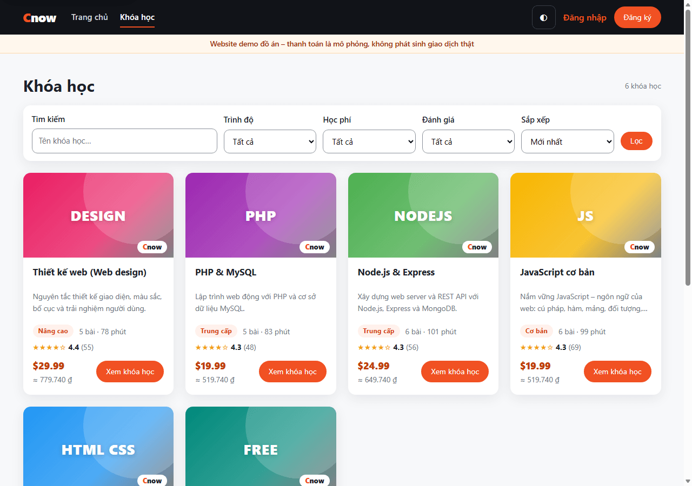 | 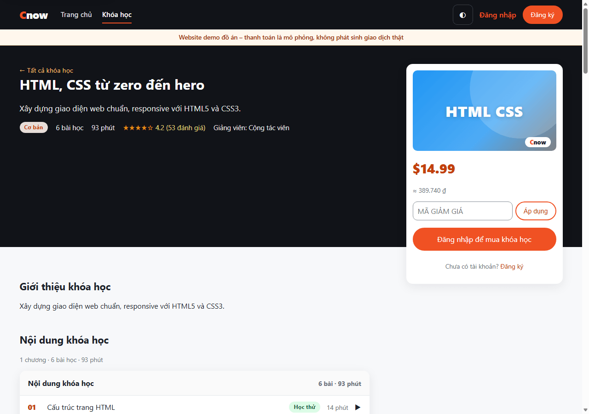 |
| 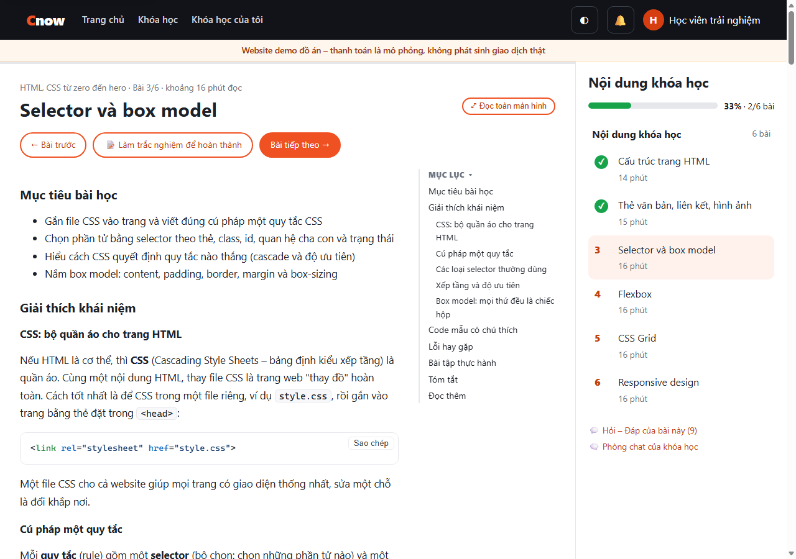 | 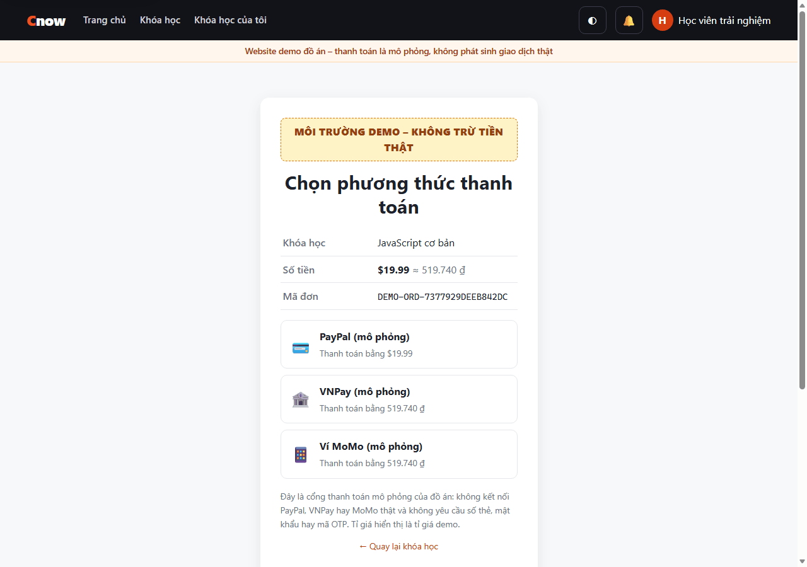 |
| 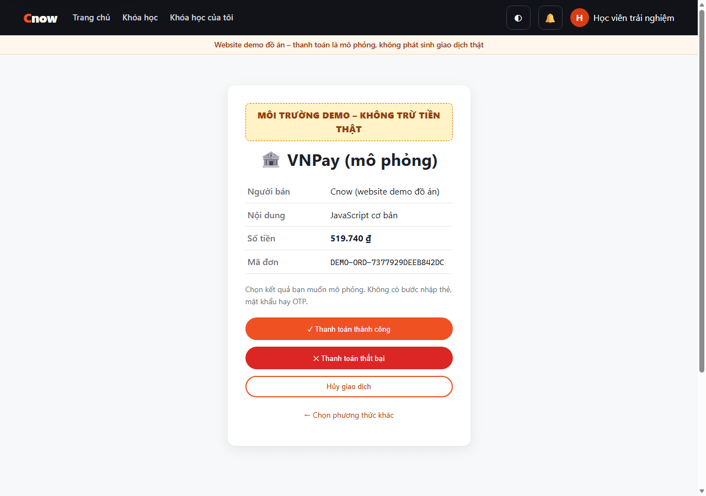 | 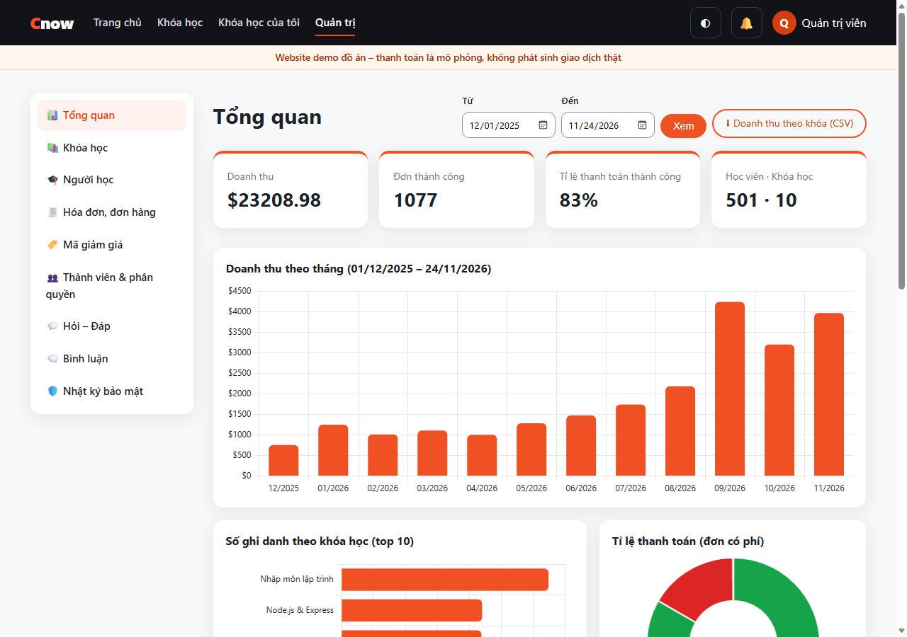 |
| 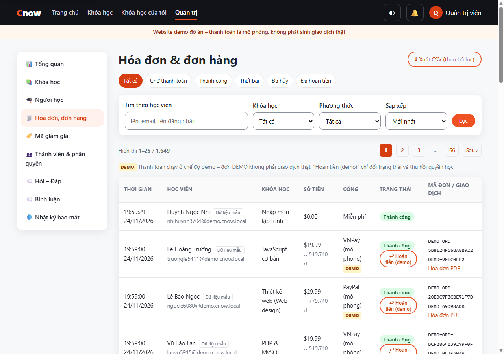 | 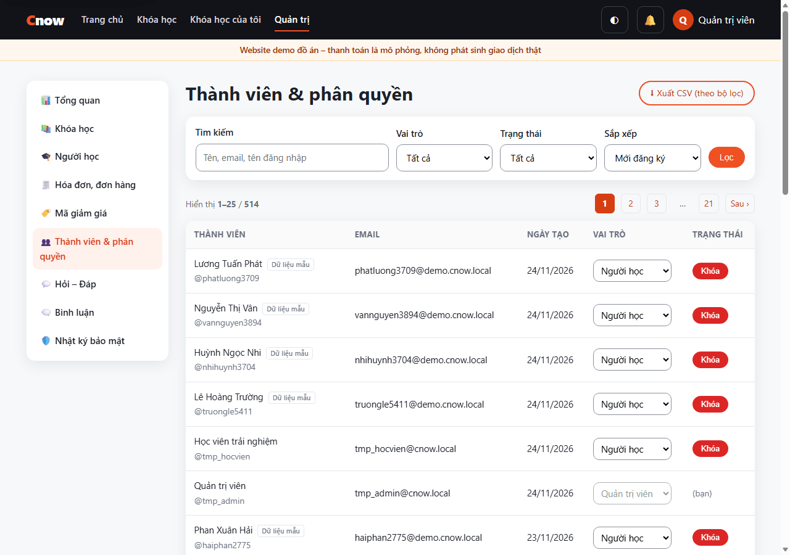 |

Trên điện thoại (chế độ tối):

<p>
  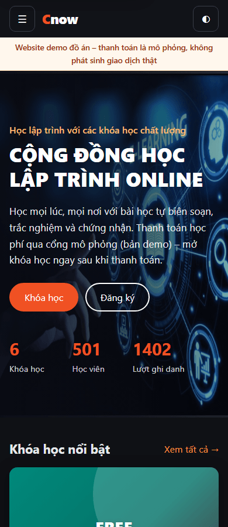
  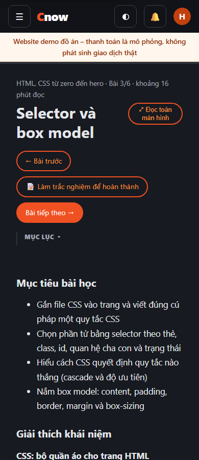
</p>

## Công nghệ

| Thành phần | Công nghệ |
| --- | --- |
| Máy chủ | Node.js 22+, Express 5, EJS, zod (kiểm tra đầu vào và cấu hình) |
| Cơ sở dữ liệu | MongoDB (Mongoose 8), phiên lưu bằng connect-mongo, ảnh trong GridFS |
| Thời gian thực | Socket.IO (chỉ WebSocket, xác thực bằng phiên, kiểm tra Origin) |
| Bài học | Markdown → marked → highlight.js → sanitize-html |
| Bảo mật | Helmet (CSP nonce), bcrypt, otplib (TOTP), express-rate-limit (lưu MongoDB), sharp |
| Hóa đơn | pdfkit + font DejaVu Sans (đủ tiếng Việt) |
| Biểu đồ | Chart.js (tự host, không dùng CDN) |
| Nhật ký | pino + pino-http (JSON, requestId, ẩn bí mật) |
| Kiểm thử | node:test (độ phủ tích hợp), supertest, mongodb-memory-server; ESLint (security, n) + Prettier; GitHub Actions, CodeQL, ZAP |
| Triển khai | Render (Blueprint `render.yaml`) + MongoDB Atlas |

## Kiến trúc

Mã nguồn chia lớp: **route mỏng** (nhận request đã kiểm tra, gọi service, render) → **service** (nghiệp vụ) → **model** (Mongoose). Mọi request đi qua cùng một chuỗi middleware bảo mật trước khi tới route.

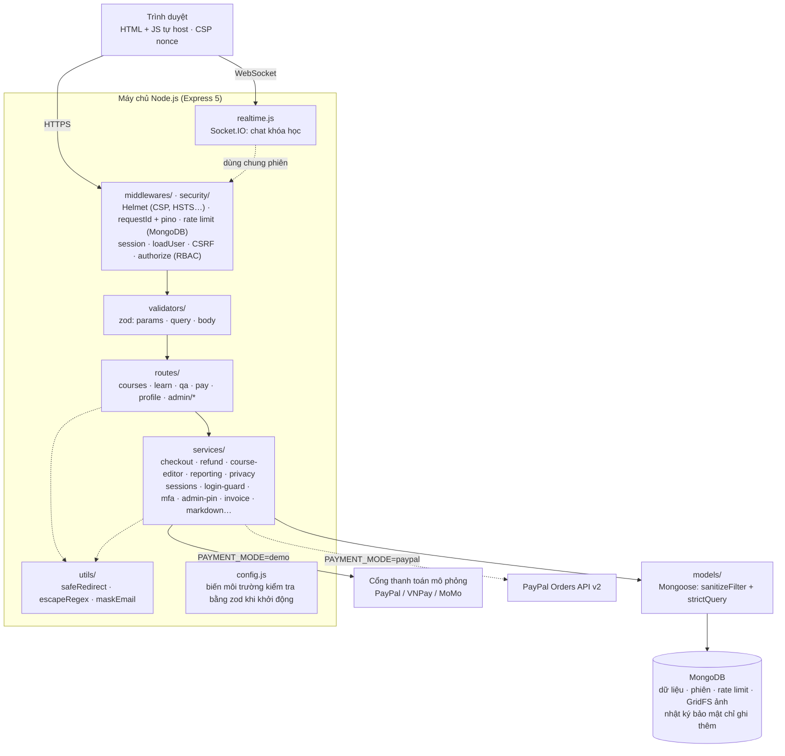
Luồng mua khóa học (bản demo):

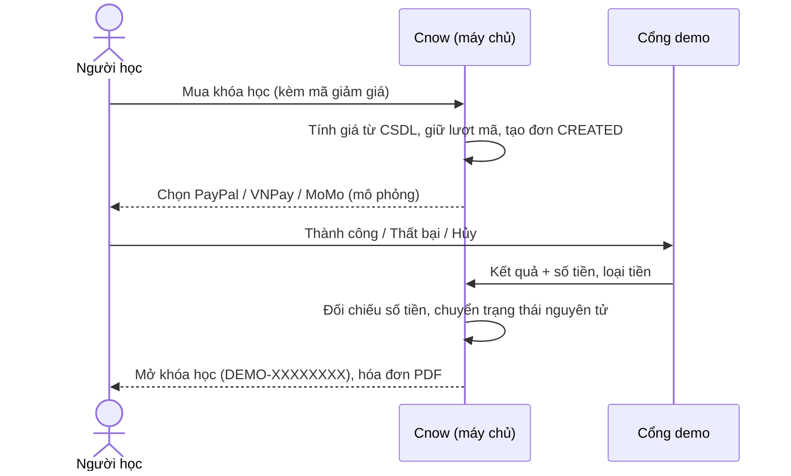

## Chạy trên máy

Cần Node.js 22+ và MongoDB (cài trên máy hoặc dùng Atlas).

```bash
git clone <repo> cnow && cd cnow
npm install
cp .env.example .env          # điền SESSION_SECRET, SEED_ADMIN_PASSWORD…
npm run seed                  # 6 khóa học + tài khoản admin (không in mật khẩu)
npm run set:admin-pin         # đặt mã quản trị cho admin (nhập ẩn 2 lần)
npm run dev                   # http://localhost:3000
```

Tùy chọn:
- `npm run seed:demo`: tạo dữ liệu mẫu (500 học viên, ~1.650 đơn hàng, hỏi – đáp, đánh giá…). Mọi nội dung mẫu đều có nhãn **“Dữ liệu mẫu”**; xóa bằng `npm run unseed:demo`.
- `npm run lint && npm test`: kiểm tra code và chạy toàn bộ kiểm thử (`npm run test:coverage` để xem độ phủ).
- `npm run backup` / `npm run restore`: sao lưu / khôi phục CSDL (xem [docs/SECURITY/backup.md](docs/SECURITY/backup.md)).

## Deploy

Bản demo chạy trên **Render + MongoDB Atlas** với `NODE_ENV=production` và `PAYMENT_MODE=demo`:

1. Tạo cluster Atlas M0, user riêng, mở Network Access và lấy chuỗi kết nối.
2. Render → **New → Blueprint** → chọn repo. `render.yaml` khai báo build `npm ci`, start `npm start` và health check `/healthz`.
3. Điền các biến bí mật: `MONGODB_URI`, `BASE_URL`, `SESSION_SECRET`, `MFA_KEY`, `SEED_ADMIN_PASSWORD`.
4. Chạy `npm run setup:prod` rồi `npm run set:admin-pin`, trỏ vào Atlas.
5. Từ đó mỗi lần `git push`, Render tự build và deploy.

Hướng dẫn từng bước, bảng biến môi trường và cách cập nhật: [docs/HUONG-DAN.md › Deploy](docs/HUONG-DAN.md#deploy-render--mongodb-atlas-bản-demo).

## Bảo mật

Bản kỷ niệm được rà soát theo OWASP ASVS 4.0.3 mức 2 (63 mục đạt, 5 mục đạt một phần, 4 mục không áp dụng). Tóm tắt:

| Lớp | Biện pháp |
| --- | --- |
| Đầu vào | Mọi route có schema zod (params sai → 404, body sai → 400, trường lạ bị bỏ); Mongoose `sanitizeFilter` chặn NoSQL injection; chuyển hướng chỉ trong site (`safeRedirect`) |
| Xác thực | Mật khẩu ≥ 10 ký tự, chặn 1.000 mật khẩu phổ biến, bcrypt; khóa lũy tiến theo tài khoản + IP; TOTP tùy chọn; admin bắt buộc mã quản trị bước 2 |
| Phiên | Cookie `__Host-` (HttpOnly, Secure, SameSite), tạo lại khi đăng nhập, hết hạn 30 phút không hoạt động / 7 ngày tuyệt đối; trang “Phiên đăng nhập” để thu hồi; báo khi đăng nhập từ IP mới |
| Phân quyền | Một bảng RBAC tập trung (`src/security/rbac.js`), kiểm thử tự động mọi route × 4 vai trò; CTV chỉ sửa khóa của mình |
| Trình duyệt | CSP nonce + `strict-dynamic`, không inline script/style; HSTS, `frame-ancestors 'none'`, COOP/CORP, Permissions-Policy; CSRF cho mọi form |
| Dữ liệu cá nhân | Tự tải dữ liệu (JSON), tự xóa tài khoản (ẩn danh hóa), che email trong log, trang `/chinh-sach-bao-mat`, script sao lưu/khôi phục |
| Giám sát | Log JSON có `requestId` (pino, ẩn bí mật); nhật ký bảo mật chỉ ghi thêm; trang `/admin/security` |
| Chuỗi cung ứng | `npm audit`, CodeQL, OWASP ZAP baseline, Dependabot, secretlint + pre-commit, CI yêu cầu độ phủ ≥ 80% |

Báo lỗ hổng: xem [SECURITY.md](SECURITY.md). Chi tiết (mô hình mối đe dọa, phân quyền, danh mục dữ liệu, sao lưu, đối chiếu ASVS): [docs/SECURITY/](docs/SECURITY/README.md).
## Ghi chú về thanh toán

- Mặc định `PAYMENT_MODE=demo`. Ba cổng mô phỏng có 3 nút *Thanh toán thành công / thất bại / Hủy giao dịch*. Máy chủ vẫn kiểm tra đầy đủ như với cổng thật: đơn thuộc đúng người, số tiền khớp, không xử lý hai lần.
- Quản trị viên có nút **Hoàn tiền (demo)**: thu hồi quyền học và ghi vào nhật ký bảo mật.
- Code tích hợp PayPal Orders API v2 thật vẫn được giữ và chỉ chạy khi `PAYMENT_MODE=paypal`. Bản demo không dùng tới nên **không có giao dịch thật nào**.
- Kịch bản trình diễn (mua thành công, thất bại, hủy, dùng mã giảm giá, admin hoàn tiền): [docs/HUONG-DAN.md › Kịch bản demo thanh toán](docs/HUONG-DAN.md#kịch-bản-demo-thanh-toán-trình-bày-trước-hội-đồng).

## Tài liệu

- [docs/HUONG-DAN.md](docs/HUONG-DAN.md): hướng dẫn chi tiết (cấu hình, soạn bài học, mã quản trị, 2FA, chat, dữ liệu demo, kiểm thử, cấu trúc thư mục).
- [docs/SECURITY/](docs/SECURITY/README.md) và [SECURITY.md](SECURITY.md): tài liệu bảo mật, chính sách báo lỗ hổng.
- Trang `/gioi-thieu` trên website: thông tin dự án và tác giả.

## Giấy phép

Phát hành theo giấy phép [MIT](LICENSE) © 2026 Hoàng Mạnh Công.
