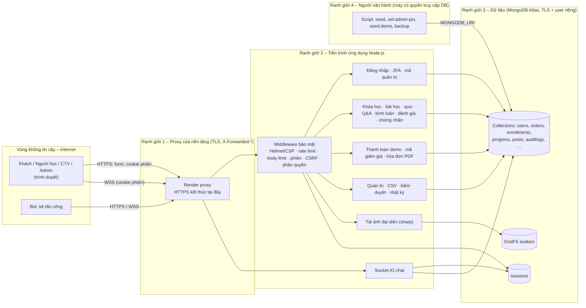

# Mô hình hóa mối đe dọa – Cnow

Tài liệu mô tả luồng dữ liệu, ranh giới tin cậy, tài sản cần bảo vệ và phân tích **STRIDE** cho từng thành phần của Cnow. Mỗi mối đe dọa ghi: biện pháp **đã có**, phần **còn thiếu** và **mức rủi ro** còn lại (Cao / Trung bình / Thấp) *trước* đợt gia cố S2–S6. Cuối tài liệu là danh sách việc cần làm, đánh số theo các mục S2–S6.

> Phạm vi: mã nguồn trong repository (Node.js/Express, MongoDB, Socket.IO), bản demo triển khai trên Render + MongoDB Atlas, thanh toán ở chế độ `PAYMENT_MODE=demo`. Ngoài phạm vi: hạ tầng của Render/Atlas, máy của người dùng, cổng thanh toán thật.

## 1. Sơ đồ luồng dữ liệu (DFD)

**Ranh giới tin cậy**

| # | Ranh giới | Dữ liệu đi qua | Giả định |
| --- | --- | --- | --- |
| 1 | Internet ↔ proxy nền tảng | HTTP(S), WebSocket | Mọi dữ liệu từ client đều không tin cậy: body, query, params, header, cookie, tên file, nội dung ảnh |
| 2 | Proxy ↔ ứng dụng | `X-Forwarded-For/Proto` | Chỉ tin **1** hop proxy (`trust proxy 1`) – không tin chuỗi IP tùy ý |
| 3 | Ứng dụng ↔ MongoDB | Truy vấn, phiên, ảnh | Kết nối TLS, user DB riêng; ứng dụng là bên duy nhất ghi dữ liệu nghiệp vụ |
| 4 | Người vận hành ↔ CSDL | Script CLI | Ai có `MONGODB_URI` thì có toàn quyền – đây là cách duy nhất đặt mã quản trị |

## 2. Tài sản cần bảo vệ

| Tài sản | Nơi lưu | Tác động nếu lộ / bị sửa | Mức quan trọng |
| --- | --- | --- | --- |
| Tài khoản (mật khẩu băm, vai trò, trạng thái khóa) | `users` | Chiếm tài khoản, leo thang quyền | Cao |
| Phiên đăng nhập (cookie `cnow.sid`, bản ghi phiên) | trình duyệt, `sessions` | Mạo danh người dùng | Cao |
| Mã quản trị, bí mật TOTP, mã khôi phục | `users.adminPinHash`, `mfaSecret` (mã hóa), `mfaRecovery` (băm) | Vượt bước 2 của admin | Rất cao |
| Đơn hàng, quyền học (enrollment), mã giảm giá | `orders`, `enrollments`, `coupons` | Học khóa có phí không trả tiền, sai doanh thu | Cao (dù thanh toán là demo) |
| Dữ liệu cá nhân (tên, email, ảnh, bio, IP trong nhật ký) | `users`, GridFS, `auditlogs` | Vi phạm quyền riêng tư | Cao |
| Nhật ký bảo mật | `auditlogs` | Che dấu vết tấn công | Trung bình |
| Nội dung khóa học, chứng nhận | `courses`, `certificates` | Phá hoại nội dung, giả chứng nhận | Trung bình |
| Bí mật cấu hình (`SESSION_SECRET`, `MFA_KEY`, `MONGODB_URI`) | biến môi trường | Giả mạo phiên, đọc toàn bộ DB | Rất cao |

## 3. Phân tích STRIDE theo thành phần

Ký hiệu: **S** Spoofing (giả mạo) · **T** Tampering (sửa đổi) · **R** Repudiation (chối bỏ) · **I** Information disclosure (lộ thông tin) · **D** Denial of service (từ chối dịch vụ) · **E** Elevation of privilege (leo thang quyền).

### 3.1 Đăng nhập, đăng ký, 2FA, mã quản trị, phiên

| STRIDE | Mối đe dọa | Đã có | Còn thiếu | Rủi ro |
| --- | --- | --- | --- | --- |
| S | Dò mật khẩu (brute force, credential stuffing) | Giới hạn 5 lần/15 phút/IP + 10 lần/15 phút/tài khoản; bcrypt cost 12; băm giả cho user không tồn tại (thời gian phản hồi đều) | Khóa **lũy tiến** (thời gian khóa tăng dần); bộ đếm mất khi khởi động lại (bộ nhớ trong); chưa chặn mật khẩu phổ biến; độ dài tối thiểu mới 8 | Trung bình |
| S | Chiếm phiên (session fixation / đánh cắp cookie) | `regenerate` sau đăng nhập; cookie HttpOnly + SameSite=Lax + Secure (HTTPS); `sessionVersion` hủy phiên khi đổi mật khẩu | Chưa có idle timeout; chưa dùng tiền tố `__Host-`; chưa có trang xem / đăng xuất từ xa các phiên; chưa báo khi đăng nhập từ IP mới | Trung bình |
| S | Vượt 2FA / mã quản trị | TOTP chống dùng lại theo bước thời gian; 5 lần sai/phiên chờ; mã quản trị bcrypt + khóa 5 lần/15 phút (tài khoản + IP), giữ lượt nguyên tử; audit | Bộ đếm IP của mã quản trị nằm trong bộ nhớ | Thấp |
| T | Sửa vai trò qua form (mass assignment) | Đăng ký chỉ nhận name/username/email/mật khẩu | Chưa có schema kiểm tra đầu vào thống nhất cho mọi route | Thấp |
| R | Người dùng chối đã đăng nhập / đổi mật khẩu | Audit log đăng nhập thành công/thất bại, đổi mật khẩu, 2FA, mã quản trị | Chưa có `requestId` để nối log truy cập với audit | Thấp |
| I | Dò tên đăng nhập | Thông báo lỗi chung "Tên đăng nhập hoặc mật khẩu không đúng" | Trang đăng ký báo "đã được sử dụng" (chấp nhận được – cần thiết cho UX) | Thấp |
| D | Khóa tài khoản người khác bằng cách cố tình nhập sai | Khóa theo tài khoản chỉ 15 phút | Khóa lũy tiến phải có trần và tách IP/tài khoản | Thấp |
| E | Người được nâng quyền admin dùng phiên cũ | Phiên admin bắt buộc có cờ bước 2 (`f2`), thiếu → đăng xuất | Đổi vai trò chưa hủy phiên cũ của người bị đổi | Thấp |

### 3.2 Thanh toán demo, mã giảm giá, hóa đơn

| STRIDE | Mối đe dọa | Đã có | Còn thiếu | Rủi ro |
| --- | --- | --- | --- | --- |
| T | Sửa giá / số tiền trong form | Giá tính lại ở server theo cent; số tiền cổng trả về được đối chiếu; sai → FAILED `amount_mismatch` | Chưa kiểm tra kiểu/định dạng tham số bằng schema | Thấp |
| T | Bấm 2 lần / 2 tab cùng lúc → xử lý 2 lần | Chuyển trạng thái nguyên tử từ `CREATED`; giữ lượt mã giảm giá nguyên tử | – | Thấp |
| S | Thanh toán / xem đơn của người khác (IDOR) | Truy vấn luôn kèm `user: req.user.id`; hóa đơn chỉ chủ đơn hoặc admin | Chưa có test tự động route × vai trò | Thấp |
| R | Admin chối đã hoàn tiền | Audit `order.refund` | – | Thấp |
| D | Tạo hàng loạt đơn rác | Giới hạn chung 600 yêu cầu/phút/IP; mỗi lần mua hủy đơn CREATED cũ | Chưa có giới hạn riêng cho `/pay` | Trung bình |
| I | Hóa đơn PDF lộ thông tin | Chỉ chủ đơn/admin; `Cache-Control: no-store` | – | Thấp |

### 3.3 Tải ảnh đại diện

| STRIDE | Mối đe dọa | Đã có | Còn thiếu | Rủi ro |
| --- | --- | --- | --- | --- |
| T | Tải file độc (PHP/SVG/HTML đổi đuôi) | Kiểm tra magic bytes (JPEG/PNG/WebP), re-encode WebP bằng sharp, tên ngẫu nhiên, chỉ phục vụ `image/webp` + `nosniff` | – | Thấp |
| D | Bom giải nén / ảnh rất lớn | Giới hạn 2MB, ≤ 4096px mỗi chiều, ≤ 16MP, sharp 1 luồng, 20 lần/giờ/người | Bộ đếm trong bộ nhớ | Thấp |
| I | EXIF/GPS trong ảnh | Ảnh xuất mới hoàn toàn, không giữ metadata | – | Thấp |
| T | Vượt CSRF bằng multipart | Multipart chỉ ở `/profile/avatar`, `verifyCsrf` ngay sau multer | – | Thấp |

### 3.4 Chat (Socket.IO)

| STRIDE | Mối đe dọa | Đã có | Còn thiếu | Rủi ro |
| --- | --- | --- | --- | --- |
| S | Kết nối từ trang khác bằng cookie nạn nhân (CSWSH) | Kiểm tra `Origin` = `BASE_URL`; chỉ WebSocket; xác thực bằng phiên | – | Thấp |
| E | Vào phòng khóa chưa ghi danh | Kiểm tra ghi danh / giảng viên khi join | – | Thấp |
| D | Spam / tin nhắn lớn | 5 tin/10 giây/người, ≤ 500 ký tự | Chưa giới hạn kích thước gói (`maxHttpBufferSize` mặc định 1MB) | Trung bình |
| T | XSS qua tin nhắn | Client chỉ dùng `textContent`; loại ký tự điều khiển | – | Thấp |

### 3.5 Hỏi – Đáp, bình luận, đánh giá, ghi chú

| STRIDE | Mối đe dọa | Đã có | Còn thiếu | Rủi ro |
| --- | --- | --- | --- | --- |
| T | XSS lưu trữ | EJS `<%= %>` escape; Markdown bài học qua sanitize-html whitelist | Chưa rà lại toàn bộ `<%- %>` bằng test | Thấp |
| T | Sửa / xóa ghi chú, vote của người khác | Truy vấn theo `user` | Chưa có schema đầu vào thống nhất | Thấp |
| D | Spam | Q&A 10 bài/giờ, bình luận 5/giờ (đếm trong DB) | – | Thấp |
| E | Học viên chọn "câu trả lời hay nhất" | Chỉ giảng viên khóa / admin | – | Thấp |

### 3.6 Trang quản trị (khóa học, người dùng, đơn hàng, kiểm duyệt)

| STRIDE | Mối đe dọa | Đã có | Còn thiếu | Rủi ro |
| --- | --- | --- | --- | --- |
| E | Thiếu kiểm tra quyền ở một route (IDOR, CTV vào trang admin) | `requireRole` ở từng route; `canEdit()` cho khóa học; test phân quyền một phần | Quyền nằm rải rác ở từng file; chưa có **bảng quyền tập trung** và test route × vai trò đầy đủ | Trung bình |
| T | CSRF trên thao tác quản trị | CSRF token mọi POST | – | Thấp |
| T | Open redirect qua tham số quay lại | `safeBack()` chỉ nhận `/admin/…`; `returnTo` chỉ đường dẫn nội bộ | Chưa gom thành 1 hàm dùng chung | Thấp |
| D | ReDoS qua ô tìm kiếm | Chuỗi tìm kiếm được escape, cắt 80 ký tự | Chưa rà toàn bộ RegExp tạo từ dữ liệu người dùng | Thấp |
| R | Admin chối đổi quyền / khóa tài khoản | Audit `user.role_change`, `user.lock` | Audit log còn sửa/xóa được bằng code (không có ràng buộc ở model) | Thấp |

### 3.7 Xuất CSV

| STRIDE | Mối đe dọa | Đã có | Còn thiếu | Rủi ro |
| --- | --- | --- | --- | --- |
| T | CSV/Formula injection (`=cmd…`) | Thêm `'` trước ô bắt đầu bằng `= + - @` | – | Thấp |
| I | CTV xuất dữ liệu khóa người khác | CTV chỉ thấy khóa của mình | – | Thấp |
| R / I | Xuất hàng loạt dữ liệu cá nhân không để lại dấu vết | – | **Chưa ghi audit** khi xuất CSV; chưa giới hạn tần suất xuất | Trung bình |

### 3.8 Chứng nhận

| STRIDE | Mối đe dọa | Đã có | Còn thiếu | Rủi ro |
| --- | --- | --- | --- | --- |
| S | Giả chứng nhận / đoán mã | Mã 16 hex ngẫu nhiên (64 bit); chỉ cấp khi hoàn thành 100% bài (quiz đạt) | Chưa giới hạn tần suất tra cứu `/verify/:code` | Thấp |
| I | Lộ chứng nhận người khác | `/certificate/:id` chỉ chủ + admin; trang verify công khai chỉ hiện tên + khóa | – | Thấp |

### 3.9 Hạ tầng ứng dụng, dữ liệu, nhật ký (dùng chung)

| STRIDE | Mối đe dọa | Đã có | Còn thiếu | Rủi ro |
| --- | --- | --- | --- | --- |
| T | NoSQL injection (`?q[$ne]=`) | Ép kiểu `String()` ở các chỗ nhận query | Chưa bật `sanitizeFilter`/`strictQuery` toàn cục | Trung bình |
| I | Log chứa PII / bí mật | Log production chỉ có đường dẫn, không query/cookie | Log chưa có cấu trúc, chưa che email; `console.error` rải rác | Trung bình |
| I | Lộ stack trace / phiên bản | Trang lỗi chung; ẩn `X-Powered-By` | Chưa có test; chưa có `security.txt` | Thấp |
| D | Request treo / body lớn | Body ≤ 50kb (1mb cho form khóa học); rate limit 600/phút | Chưa đặt timeout request; rate limit lưu trong bộ nhớ | Trung bình |
| I | CSP chưa đủ chặt | CSP `'self'`, không inline | Chưa có nonce, Permissions-Policy, Referrer-Policy rõ ràng | Thấp |
| I | Quyền riêng tư | Chỉ lưu dữ liệu cần thiết cho chức năng | Chưa có trang chính sách, tự tải / tự xóa dữ liệu, danh mục dữ liệu cá nhân, sao lưu | Trung bình |
| R | Không phát hiện tấn công đang diễn ra | Audit log + trang lọc | Chưa có trang giám sát tổng hợp (đăng nhập thất bại, IP đáng ngờ) | Trung bình |

## 4. Danh sách việc (từ cột "Còn thiếu")

| Mã | Việc | Mục |
| --- | --- | --- |
| T-01 | Schema zod cho body/query/params mọi route; lỗi trả thông báo chung | S2 |
| T-02 | `mongoose.set('sanitizeFilter', true)` + `strictQuery`; không đưa object người dùng vào truy vấn | S2 |
| T-03 | Rà mọi `RegExp` từ dữ liệu người dùng (escape + giới hạn độ dài) – gom vào 1 hàm | S2 |
| T-04 | Rà `<%- %>` và kiểm thử XSS cho Markdown / Q&A / bình luận | S2 |
| T-05 | Chống mass assignment: chỉ nhận field cho phép khi tạo/sửa model | S2 |
| T-06 | Một hàm `safeRedirect` dùng chung cho mọi tham số quay lại | S2 |
| T-07 | Mật khẩu ≥ 10 ký tự, chặn 1000 mật khẩu phổ biến | S3 |
| T-08 | Khóa lũy tiến theo tài khoản + IP, lưu trong MongoDB | S3 |
| T-09 | Báo khi đăng nhập từ IP mới; trang "Phiên đăng nhập" đăng xuất từ xa | S3 |
| T-10 | Idle timeout 30 phút + tuyệt đối 7 ngày; cookie `__Host-` ở production; hủy phiên khi bị đổi vai trò | S3 |
| T-11 | Bảng quyền tập trung (`rbac.md` + 1 middleware) và test route × vai trò | S3 |
| T-12 | Danh mục dữ liệu cá nhân; tự tải dữ liệu (JSON), tự xóa tài khoản (ẩn danh hóa đơn hàng) | S4 |
| T-13 | Che email / PII trong log | S4 |
| T-14 | Trang `/chinh-sach-bao-mat`; script sao lưu / khôi phục | S4 |
| T-15 | CSP có nonce, HSTS, Referrer-Policy, Permissions-Policy, COOP/CORP – có test | S5 |
| T-16 | Rate limit theo nhóm route, store MongoDB (đăng nhập, đăng ký, bình luận, thanh toán, xuất CSV, mã quản trị, tra cứu chứng nhận) | S5 |
| T-17 | Timeout request; xử lý lỗi tập trung không lộ stack (có test) | S5 |
| T-18 | Socket.IO: `maxHttpBufferSize` nhỏ | S5 |
| T-19 | `/.well-known/security.txt`; `/healthz` không lộ phiên bản | S5 |
| T-20 | Logger có cấu trúc (pino) + `requestId` | S6 |
| T-21 | Audit đủ sự kiện (xuất CSV, xuất dữ liệu, xóa tài khoản, đăng xuất từ xa, IP mới); audit log không sửa/xóa được | S6 |
| T-22 | Trang `/admin/security`: đăng nhập thất bại, tài khoản bị khóa, IP đáng ngờ trong 24 giờ | S6 |

Trạng thái thực hiện từng việc được cập nhật trong [`README.md`](README.md) của thư mục này sau khi hoàn thành.
